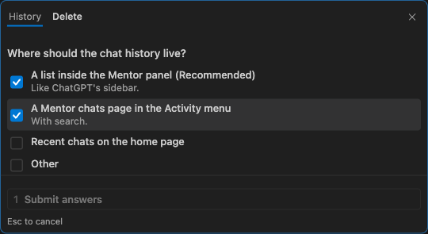

# Question window

When an agent needs you to decide something, it can ask in a small window on
your laptop instead of in Slack. The window copies the question card from the
Claude Code VS Code panel: a tab per question, pick one or pick any, an
**Other** box for your own answer, **1 Submit answers** and **Esc to cancel**.



It's built for `/manager`, which takes requests from Slack and needs your
decisions before it plans or starts work. Any agent can use it.

## What you need

- Python 3 (macOS ships with it). No packages to install.
- Google Chrome, for the small app window. Without Chrome it opens in your
  default browser.
- On macOS, the window opens over Slack, on the screen Slack is on, and comes
  to the front.

## How it works

1. The agent writes the questions to `.claude/grill/questions.json` and runs:

   ```bash
   python3 .claude/scripts/grill_app.py
   ```

2. The window opens. Answer each tab and press **Submit answers** (or press
   `1`).
3. Your answers are saved to `.claude/grill/answers/<id>-<time>.json`, and
   the script exits. **Esc** or the close button saves a file marked
   `"declined": true`. Closing the window without answering saves nothing.
4. `/manager`'s Slack watcher (`.claude/scripts/slack-watch.sh`) reports the
   new file as `GRILL_ANSWERS <file>`, so the agent reads your answers
   straight away.

`.claude/grill/` is git-ignored. The questions and answers stay on your
machine.

To answer again, run the same command yourself. It reopens the questions that
are waiting.

## Questions file

```json
{
  "id": "mentor-chats",
  "title": "Mentor chats: 3 questions",
  "questions": [
    {
      "id": "Q1",
      "header": "Ticket",
      "question": "Change ODY-937 or make a new ticket?",
      "multi": false,
      "options": [
        {
          "label": "Change 937",
          "description": "Part 1 isn't a PR yet, so it's cheaper now.",
          "recommended": true
        },
        { "label": "New ticket that builds on 937" }
      ]
    }
  ]
}
```

- `header` is the tab label. Keep it to one or two words.
- `multi: true` shows tick boxes (pick any). Otherwise it's pick one, and
  picking moves to the next tab.
- `recommended` adds "(Recommended)" to the label. Put the recommended option
  first.
- Every question gets an **Other** option for a typed answer. Don't add your
  own.
- Use a new `id` for each set of questions, so their answer files don't mix.

## Answers file

```json
{
  "id": "mentor-chats",
  "declined": false,
  "answers": [
    {
      "id": "Q1",
      "header": "Ticket",
      "question": "Change ODY-937 or make a new ticket?",
      "picked": [1],
      "labels": ["Change 937"],
      "other": null
    }
  ],
  "compact": "1:1",
  "answeredAt": "2026-11-18T16:05:22.009Z"
}
```

`picked` holds 1-based option numbers. `other` is the typed answer, or `null`.

## Rules for agents

- Only your own developer answers in the window, so an answer file counts as
  their reply. Repeat their picks in the Slack thread before you act on them.
- Never put secrets, tokens or student data in a question.
- When the window can't open (a cloud session, or no desktop), ask in Slack
  with numbered options instead.

## Testing it

`GRILL_NO_OPEN=1` prints the URL instead of opening a window, and
`GRILL_OUT_DIR=<dir>` saves answers there instead of `.claude/grill/answers/`.
Open the URL with the Playwright MCP to click through it.

The look comes from the extension's CSS modules `_hONcXw` (the questions) and
`_qlaBag` (the card and buttons) in
`~/.vscode/extensions/anthropic.claude-code-*/webview/index.css`, with the
VS Code Dark Modern and Light Modern colours filled in. If the extension's
card changes, update `grill_app.html` from there.
