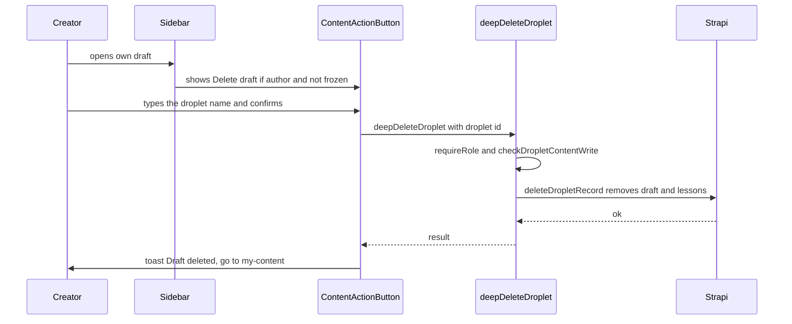

title: Let authors delete their own draft, and check permissions on delete (ODY-211)
risk: 🔴 careful
kind: major
---
## Walkthrough

Creators can now delete a draft they started by mistake. A red "Delete draft" button in the editor sidebar asks them to type the droplet's name, then removes the draft and its lessons. The delete request itself now checks who is asking, which it did not before.

## Changes

| Layer / Files | Summary |
| --- | --- |
| **Delete confirmation dialog** `frontend/components/draft/metadata/content-action-button.tsx` | New `deleteDraft` action. The author types the droplet name to confirm. On success it shows "Draft deleted" and goes to `/my-content`. |
| **Sidebar button** `frontend/components/draft/sidebar.tsx` | Shows the button only to an author of an unpublished draft that is not frozen for review. |
| **Permission check on delete** `frontend/lib/requests/droplet.ts`, `frontend/testing/security/server-action-auth-allowlist.ts` | `deepDeleteDroplet` now calls `requireRole` and `checkDropletContentWrite` (same rule as `updateDroplet`). Its allowlist entry is removed. Internal cleanup in `duplicateDroplet` uses a private `deleteDropletRecord` with no check. |
| **Tests** `frontend/testing/requests/droplet-auth.test.ts`, `frontend/tests/components/draft/content-action-button.test.tsx`, `frontend/tests/components/draft/sidebar.test.tsx` | Cover the refusals, the type-the-name flow and when the button shows. |

## How it flows

**Estimated review effort:** 3 (Moderate) · ~20 minutes
**Merge risk:** Medium. It deletes data and changes a `"use server"` export, so a wrong check could let the wrong person delete, or block admins.
**Depends on:** nothing
**Overlaps:** `claude/ody-471-preview-sync` (`sidebar.tsx`, `sidebar.test.tsx`); `claude/ody-616-components-lint` (`content-action-button.tsx`, `sidebar.tsx`); `claude/ody-615-lib-types-lint` (`droplet.ts`); `claude/ody-718-dead-request-functions` (the allowlist file)
**Suggested reviewers:** `AwadBuisir10`
**Note:** Behaviour change: authors are refused while the droplet is in review. System Admins and Content Editors can still delete.
**Note:** `deleteDropletRecord` skips the check on purpose. Only `duplicateDroplet` calls it, after its own check.

## How to test on dev

1. As a creator, open your own unpublished draft → a red "Delete draft" button is in the sidebar.
2. Click it and type a wrong name → the delete does not go through.
3. Type the exact name and confirm → "Draft deleted" toast, you land on `/my-content`, and the draft is gone.
4. Open a published droplet, and a draft that is in review → no Delete draft button for the author.
5. As a non-admin who is not an author, try to delete someone else's draft → refused.

## Checklist

- [ ] My code follows the code style of this project.
- [ ] I have moved the ticket to "In Review"
- [ ] I have added reviewers to this PR
- [ ] I have updated the documentation accordingly.
- [x] I have added tests to cover my changes.
- [ ] All new and existing tests passed.
- [x] Every new/changed export in a `"use server"` file calls `requireRole`/`withAuth`, or is listed in the auth allowlist with a reason.
