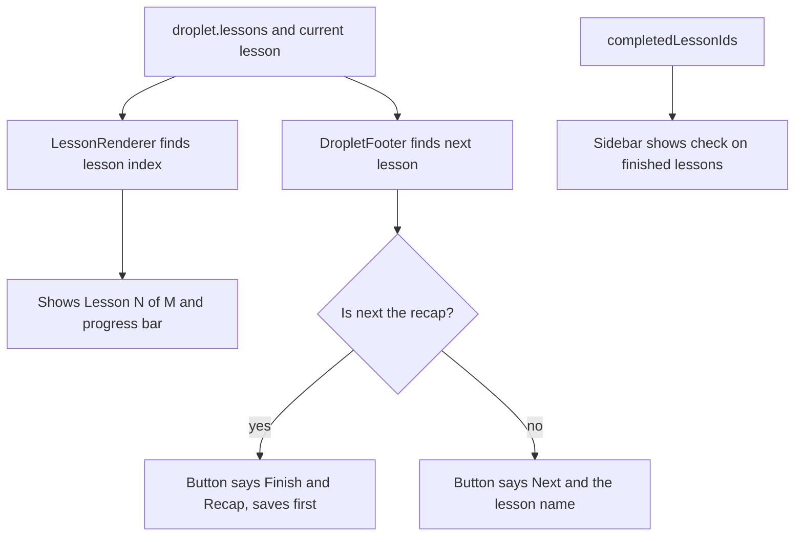

title: Show lesson position, finished lessons and the next lesson's name (ODY-529)
risk: 🟡 test on dev
kind: major
---
## Walkthrough

Learners now see where they are in a droplet. Each lesson page shows "Lesson 2 of 5" with a progress bar, the sidebar puts a check next to finished lessons, and the footer button names the next lesson. This shows on every droplet lesson page.

## Changes

| Layer / Files | Summary |
| --- | --- |
| **Position and progress bar** `frontend/components/droplets/lessons/lesson-renderer.tsx`, `frontend/tests/components/droplets/lesson-renderer.test.tsx` | Finds the lesson's index in `droplet.lessons` and shows "Lesson N of M" with a progress bar above the title. Nothing shows if the lesson is not in the list. |
| **Sidebar check marks** `frontend/components/droplets/sidebar.tsx`, `frontend/tests/components/droplets/sidebar.test.tsx` | Unlocked lessons in `completedLessonIds` get a check icon and "Completed" for screen readers. The back link now reads "Explore". |
| **Footer next button** `frontend/components/droplets/footer.tsx`, `frontend/tests/components/droplets/footer.test.tsx` | The button reads "Next: <lesson name>", or "Finish → Recap" on the last lesson. Long names are cut off, with the full name in the tooltip and aria-label. |

## How it flows

**Estimated review effort:** 2 (Simple) · ~10 minutes
**Merge risk:** Low. It only changes display on learner pages. The next button still saves progress the same way.
**Depends on:** nothing
**Overlaps:** `claude/ody-527-tailwind-classes` (`footer.tsx`, `lesson-renderer.tsx`); `claude/ody-616-components-lint` (`lesson-renderer.tsx`, `sidebar.tsx`); `claude/ody-446-callout-style` (`lesson-renderer.tsx`)
**Suggested reviewers:** `AwadBuisir10`
**Note:** The progress bar uses a fixed colour (`#2D7597`), not a theme token.

## How to test on dev

1. Open a droplet with several lessons at lesson 1 → "Lesson 1 of N" and a thin bar show above the title.
2. Finish a lesson and look at the sidebar → a green check shows beside it.
3. Check the footer → the button reads "Next: <name>". Hover shows the full name.
4. Go to the last lesson → the button reads "Finish → Recap" and still saves progress before the recap.
5. Check the sidebar's top link → arrow and "Explore", going to `/explore`.

## Checklist

- [ ] My code follows the code style of this project.
- [ ] I have moved the ticket to "In Review"
- [ ] I have added reviewers to this PR
- [ ] I have updated the documentation accordingly.
- [x] I have added tests to cover my changes.
- [ ] All new and existing tests passed.
- [x] Every new/changed export in a `"use server"` file calls `requireRole`/`withAuth`, or is listed in the auth allowlist with a reason.
