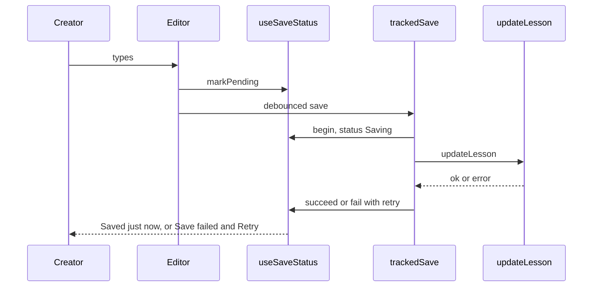

title: Show Saving, Saved and Failed with Retry in the draft editor (ODY-535)
risk: 🟡 test on dev
kind: major
---
## Walkthrough

Creators editing a draft lesson now see whether their work was saved. The toolbar shows "Unsaved changes", "Saving…", "Saved just now" or "Save failed" with a Retry button. The browser warns before closing with unsent changes, and a banner says when the editing lock is lost.

## Changes

| Layer / Files | Summary |
| --- | --- |
| **Save state hook** `frontend/hooks/useSaveStatus.ts`, `frontend/tests/hooks/useSaveStatus.test.tsx` | New hook with six states (idle, pending, saving, saved, failed, frozen). It keeps a retry callback and adds a `beforeunload` warning while changes are unsent. |
| **Toolbar indicator** `frontend/components/draft/lesson/save-status-indicator.tsx` | Shows the label in a polite live region, with a Retry button on failure. |
| **Autosave wiring** `frontend/components/draft/lesson/lesson-renderer.tsx` | Both autosave paths (classic blocks and BlockNote) go through one `trackedSave` that reports start, success or failure. Review freezes show "In review, changes aren't saved", not an error. Removes the old "Changes saved automatically" line. |
| **Lock-lost banner** `frontend/components/draft/lesson/lesson-renderer.tsx`, `frontend/tests/components/draft/lesson-renderer-save-status.test.tsx` | Shows an amber notice when the editor loses its lock mid-session, and clears it when the lock returns. |

## How it flows

**Estimated review effort:** 3 (Moderate) · ~20 minutes
**Merge risk:** Medium. It rewires autosave inside a large file that other branches also edit, so a mistake could hide a failed save or block one.
**Depends on:** nothing
**Overlaps:** `claude/ody-281-delete-spinners`, `claude/ody-471-preview-sync`, `claude/ody-879-flag-scroll-to-block`, `claude/ody-897-remove-mark-addressed` (all `frontend/components/draft/lesson/lesson-renderer.tsx`, expect conflicts)
**Suggested reviewers:** `AwadBuisir10`
**Note:** Saves still use the existing `updateLesson` action. No server code changed.

## How to test on dev

1. Open a draft lesson and type → "Unsaved changes", then "Saving…", then "Saved just now".
2. Go offline in dev tools and type → "Save failed" with Retry. Go online and click Retry → it saves.
3. With unsent changes, try to close the tab → the browser asks you to confirm.
4. Open the same lesson as another editor so the lock is taken → the first editor shows "You lost the editing lock" and goes read-only.
5. Open a droplet that is in review → the indicator says changes aren't saved, with no error.

## Checklist

- [ ] My code follows the code style of this project.
- [ ] I have moved the ticket to "In Review"
- [ ] I have added reviewers to this PR
- [ ] I have updated the documentation accordingly.
- [x] I have added tests to cover my changes.
- [ ] All new and existing tests passed.
- [x] Every new/changed export in a `"use server"` file calls `requireRole`/`withAuth`, or is listed in the auth allowlist with a reason.
