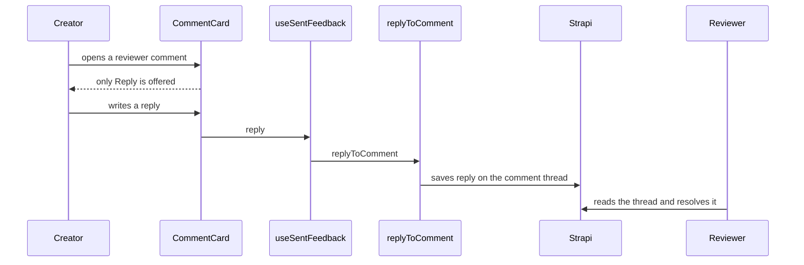

title: Remove Mark addressed from review comments; creators reply instead (ODY-897)
risk: 🔴 careful
kind: major
---
## Walkthrough

Creators no longer see a "Mark addressed" button on reviewer comments. They answer a comment by replying, and the reviewer resolves it. The addressed notes and counts are gone from the lesson and overview review panels, for both creators and reviewers.

## Changes

| Layer / Files | Summary |
| --- | --- |
| **Server action removed** `frontend/lib/requests/reviews.ts`, `frontend/testing/requests/reviews-addressed.test.ts`, `frontend/testing/contract/strapi-query-catalog.ts` | Deletes the exported `markAddressed` action and its helper type. `addressedAt` is no longer fetched with comments. The test file and query catalog entry go too. |
| **Hook and helpers** `frontend/hooks/use-sent-feedback.ts`, `frontend/lib/review-comments.ts`, `frontend/types/index.d.ts` | Drops `markAddressed` from the hook, the `addressed` count and text from the helpers, and the field from the types. |
| **Review UI** `frontend/components/draft/review/*`, `frontend/components/draft/lesson/lesson-renderer.tsx` | Removes the button, the "Marked addressed" note, and the addressed counts from the card, strips, tags, layers, overview feedback, section comments and outdated list. |
| **Carry-over and docs** `backend/src/lib/review-workflow.ts`, `backend/tests/api/review-workflow.test.js`, `docs/agent/*.md` | A new review round no longer copies `addressedAt`. Docs updated. |
| **Component and hook tests** `frontend/tests/components/draft/*`, `frontend/testing/hooks/*` | Updated to match. |

## How it flows

**Estimated review effort:** 3 (Moderate) · ~25 minutes
**Merge risk:** Medium. It touches many review files and removes a `"use server"` export, so check nothing still calls `markAddressed`. Nothing new is exposed.
**Depends on:** nothing
**Overlaps:** `claude/ody-535-draft-save-feedback`, `claude/ody-281-delete-spinners`, `claude/ody-471-preview-sync`, `claude/ody-879-flag-scroll-to-block` (`frontend/components/draft/lesson/lesson-renderer.tsx`); `claude/ody-878-scan-fingerprint`, `claude/ody-915-prompt-saved-by` (`docs/agent/backend-architecture.md`); `claude/ody-488-group-refresh`, `claude/ody-718-dead-request-functions` (`frontend/testing/contract/strapi-query-catalog.ts`); `claude/ody-615-lib-types-lint` (`frontend/types/index.d.ts`)
**Suggested reviewers:** `AwadBuisir10`
**Note:** `addressedAt` stays in the Strapi schema, unused, for one release. Old marks keep their value but nothing shows it.
**Note:** Behaviour change: submitting a new round no longer copies an old addressed mark.

## How to test on dev

1. As a creator, open a draft with sent reviewer feedback → no Mark addressed button, note or count on any comment.
2. Reply to a comment → the reply shows in the thread.
3. As the reviewer, open the same comment → no "creator marked this addressed" line, and you can still resolve it.
4. Submit the draft for another review round → unresolved comments carry over with no addressed mark.
5. Check the overview feedback and section comments panels the same way.

## Checklist

- [ ] My code follows the code style of this project.
- [ ] I have moved the ticket to "In Review"
- [ ] I have added reviewers to this PR
- [x] I have updated the documentation accordingly.
- [x] I have added tests to cover my changes.
- [ ] All new and existing tests passed.
- [x] Every new/changed export in a `"use server"` file calls `requireRole`/`withAuth`, or is listed in the auth allowlist with a reason.
