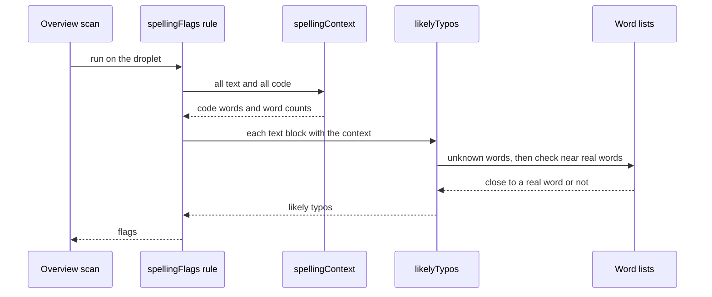

title: Make the Overview scan spelling check work offline, with no AI call (ODY-924)
risk: 🟡 test on dev
kind: major
---
## Walkthrough

The spelling check on the Overview scan no longer calls AI. It flags a word only when it is one or two letters away from a real word, such as "teh" or "recieve". Creators and reviewers see fewer and steadier flags, and the scan no longer spends AI budget.

## Changes

| Layer / Files | Summary |
| --- | --- |
| **Offline typo finder** `frontend/lib/overview-scan/spelling.ts`, `frontend/testing/lib/overview-scan/spelling.test.ts` | Removes the Claude call, budget check and usage record. Adds `spellingContext` and `likelyTypos`, which look for a real word within two edits. Names, words in code, hyphenated words and words used three or more times pass. |
| **Rule wiring** `frontend/lib/overview-scan/rules/content.ts`, `frontend/lib/overview-scan/text.ts`, `frontend/testing/lib/overview-scan/rules/content.test.ts` | The spelling rule builds one context for the whole droplet, then flags typos per text block. The "AI double-check didn't run" note and the unused `sentenceAround` helper are gone. The rule text is reworded. |
| **Config and word lists** `frontend/lib/overview-scan/config.ts`, `frontend/package.json`, `frontend/package-lock.json` | Bumps `RULES_VERSION`, adds a few tech words, drops the AI limits. Adds three `@cspell/dict-*` packages as extra word lists. |
| **Deleted test** `frontend/testing/lib/overview-scan/rules/spelling-ai.test.ts` | Removed with the AI path. |

## How it flows

**Estimated review effort:** 3 (Moderate) · ~20 minutes
**Merge risk:** Medium. It changes what the scan flags, adds three dependencies, and reads word lists from `node_modules` at runtime, so check the production build includes them.
**Depends on:** nothing
**Overlaps:** `claude/ody-876-no-repeats-quote` (`frontend/lib/overview-scan/config.ts`, both change `RULES_VERSION`); `claude/ody-911-remove-uuid` (`frontend/package.json`, `frontend/package-lock.json`, expect a lockfile conflict)
**Suggested reviewers:** `AwadBuisir10`
**Note:** Unfamiliar words that are not close to a real word are no longer flagged.

## How to test on dev

1. Write a lesson with "teh" and "recieve", then run the Overview scan → both are flagged.
2. Add a product name, a word used only in a code block, and a word used three or more times → none are flagged.
3. Run the scan with the AI budget used up or the network blocked → spelling still runs and no AI note shows.
4. Open the scan page → the spelling rule text reads the new wording.

## Checklist

- [ ] My code follows the code style of this project.
- [ ] I have moved the ticket to "In Review"
- [ ] I have added reviewers to this PR
- [ ] I have updated the documentation accordingly.
- [x] I have added tests to cover my changes.
- [ ] All new and existing tests passed.
- [x] Every new/changed export in a `"use server"` file calls `requireRole`/`withAuth`, or is listed in the auth allowlist with a reason.
