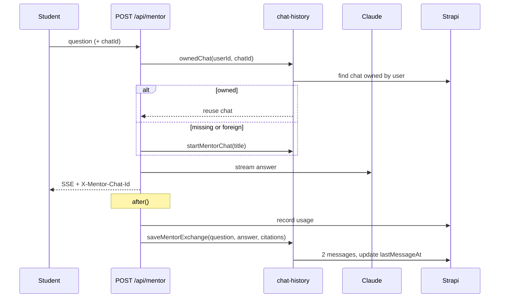

title: Mentor saves each student's chats on the server so they can come back to them (ODY-937)
risk: 🔴 careful
kind: major
---

## Walkthrough

Mentor chats used to live only in React state, so a reload lost them. This PR adds the server half of chat history: two Strapi types (`mentor-chat`, `mentor-message`), server helpers that save each finished exchange from `POST /api/mentor`, and owner-only server actions for listing, opening and deleting a student's chats. Chats are student-only, instructors have no route to them, and anything older than 30 days is deleted. The UI is PR 2.

**Review fixes:** Chat text is now readable only through owner-only Strapi routes, and a daily cleanup job deletes chats and messages older than 30 days.

## Changes

| Layer / Files | Summary |
| --- | --- |
| Strapi: `backend/src/api/mentor-chat`, `mentor-message`, generated types | Two types, `draftAndPublish: false`. Core routers only, no role is granted them, so just the service token reaches them. |
| Server helpers: `frontend/lib/mentor/chat-history.ts` | `startMentorChat`, `ownedChat`, `saveMentorExchange`, `purgeExpiredMentorChats`, `MENTOR_CHAT_RETENTION_DAYS = 30`. `server-only`; logs ids, counts and error names, never text. |
| Route: `app/api/mentor/route.ts`, `lib/mentor/answer.ts`, `lib/validations/mentor.ts` | Optional `chatId` (lesson/explain only); reuses an owned chat or starts one; `X-Mentor-Chat-Id` header; `after()` saves the exchange. Quiz hints are never saved. A save failure never breaks the answer. |
| Server actions: `lib/requests/mentor-chats.ts`, `lib/cache-tags.ts` | `listMentorChats` (purges expired first), `getMentorChat`, `deleteMentorChat`, `deleteAllMentorChats`. Each calls `requireRole([])`, uses the session user's id, validates ids with Zod. New tag `mentorChats(userId)`. |
| Hook: `hooks/use-mentor-chat.ts` | Sends the returned chat id back on the next ask; new `clear()` resets it. No other UI. |
| Tests | Backend schema/route test; Jest for helpers, route, actions, hook, no-text-in-logs. |

## How it flows

## Review

- **Estimated review effort:** about 45 minutes. The ownership checks and the log-safety are the parts to read closely.
- **Merge risk:** 🔴 careful. It stores students' own words (approved, ODY-883) and adds two content types, so a migration runs on deploy.
- **Depends on:** none.
- **Overlaps:**
  - Brady's ODY-936 and ODY-940 edit `mentor-message.tsx`, which this PR does not touch.
  - ODY-890 follow-up: `mentor-feedback` still copies answer text when shared. Link a rating to the saved message instead. Not changed here.
  - The ODY-931 cron can call `purgeExpiredMentorChats()`.
- **Suggested reviewer:** `JaylenZeng`

## How to test on dev

1. Sign in as a student and open a lesson with Mentor on.
2. Ask a question and check the response has an `X-Mentor-Chat-Id` header (browser network tab).
3. Ask a second question: the request body carries `chatId` and the header stays the same.
4. In Strapi admin, check one `mentor-chat` with 4 `mentor-message` rows and a `lastMessageAt`.
5. Ask a quiz hint: no new chat or messages.
6. Set a chat's `lastMessageAt` to 31 days ago, then call `listMentorChats` (PR 2 UI, or a temporary call): it is gone with its messages.

## Checklist

- [ ] My code follows the code style of this project.
- [ ] I have moved the ticket to "In Review"
- [ ] I have added reviewers to this PR
- [ ] I have updated the documentation accordingly.
- [x] I have added tests to cover my changes.
- [ ] All new and existing tests passed.
- [x] Every new/changed export in a `"use server"` file calls `requireRole`/`withAuth`, or is listed in the auth allowlist with a reason.
